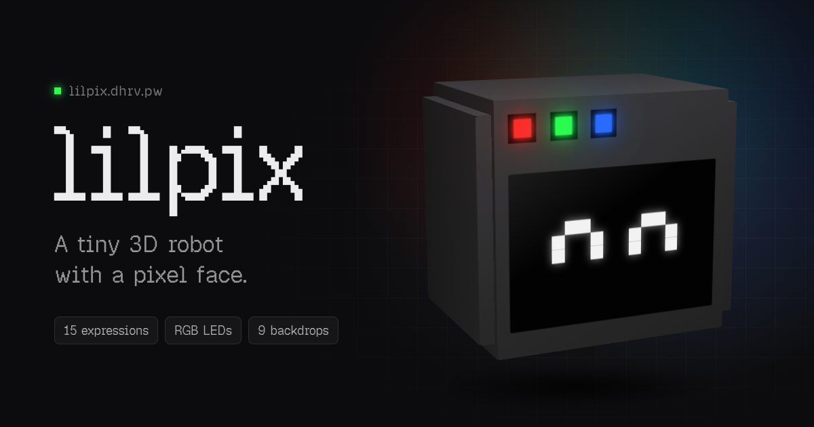

# lilpix

A tiny 3D robot with a pixel-art face. Click it, and it changes its mind.

**[lilpix.dhrv.pw](https://lilpix.dhrv.pw)**



## What it does

- **15 expressions**, each with its own eye grid, LED pattern and chiptune sound
- **RGB LEDs** that breathe, blink, chase or cycle through a rainbow, with bloom
- **9 backdrops** (gradients, grids, sparkles), each in a light and a dark version
- **Follows you**: the eyes track your cursor, or your phone's tilt on mobile
- **Command menu** with live previews: hover an expression or backdrop to try it

Settings (theme, backdrop, sound, LEDs, follow, fog) are saved in `localStorage`.

## Controls

| Input           | Action                                  |
| --------------- | --------------------------------------- |
| Click the bot   | Next expression                         |
| `1`–`9`         | Jump to one of the first nine           |
| `⌘K` / `Ctrl+K` | Open the command menu                   |
| Drag / scroll   | Orbit and zoom                          |
| Tilt (phone)    | Look around (iOS asks on the first tap) |

## Running locally

Needs Node 22.18+ and [pnpm](https://pnpm.io). The project uses [Vite+](https://viteplus.dev) (`vp`), which pnpm installs with everything else.

```bash
pnpm install
pnpm dev
```

| Script         | What it does                                                             |
| -------------- | ------------------------------------------------------------------------ |
| `pnpm dev`     | Start the dev server                                                     |
| `pnpm build`   | Type-check and build to `dist/`                                          |
| `pnpm preview` | Serve the production build                                               |
| `pnpm check`   | Format, lint and type-check                                              |
| `pnpm og`      | Re-render `public/og.png` from `og/og.html` (macOS, needs Google Chrome) |

## How it's built

[React](https://react.dev) + [React Three Fiber](https://r3f.docs.pmnd.rs) on [three.js](https://threejs.org), with [drei](https://drei.docs.pmnd.rs) helpers and a bloom pass from [postprocessing](https://github.com/pmndrs/react-postprocessing). Menu by [cmdk](https://cmdk.paco.me) and [vaul](https://vaul.emilkowal.ski), sounds by [@web-kits/audio](https://www.npmjs.com/package/@web-kits/audio), icons by [Phosphor](https://phosphoricons.com).

```
src/
├── App.tsx          Scene, lighting, toolbar, keyboard shortcuts
├── Bot.tsx          The robot: body, screen, pixel eyes, LEDs, look-at
├── expressions.ts   Eye grids and LED patterns for every expression
├── sounds.ts        A short synth motif per expression
├── backgrounds.ts   Backdrop palettes (light + dark) and menu swatches
├── Backdrop.tsx     Renders a backdrop inside the WebGL scene
├── CommandMenu.tsx  ⌘K dialog on desktop, bottom drawer on mobile
├── CameraFit.tsx    Fits the camera to the viewport on resize
├── SceneFog.tsx     Optional fog that scales with camera distance
├── tilt.ts          Device-orientation input for phones
├── hooks.ts         usePersistent, useMediaQuery
└── icons.tsx        Phosphor icons at one size and weight
```

A few details:

- **Eyes are one draw call.** Every lit pixel is an instance of a single `InstancedMesh`, so a face costs the same however many pixels it lights.
- **Only the LEDs glow.** Bloom has a luminance threshold of 1, and only the LED emissive is pushed past it. Each LED is scaled so blue glows as strongly as green.
- **Backdrops live in the scene, not in CSS.** Bloom only draws over pixels the canvas renders, so a CSS background behind a transparent canvas would lose the glow.
- **Resolution adapts.** `PerformanceMonitor` lowers the pixel ratio while frames drop and raises it again when there's headroom.

## Adding an expression

Add an entry to `EXPRESSIONS` in [`src/expressions.ts`](src/expressions.ts). Each eye is a grid of strings where `#` lights a pixel. `right` defaults to the mirror of `left`.

```ts
shocked: {
  left: ["###", "#.#", "###"],
  leds: { colors: ["#ffffff", "#ffffff", "#ffffff"], mode: "blink", speed: 6 },
},
```

TypeScript then asks for a matching sound in [`src/sounds.ts`](src/sounds.ts). The menu, shortcuts and click cycle pick it up from there.

Backdrops work the same way: add one to `BACKGROUNDS` in [`src/backgrounds.ts`](src/backgrounds.ts) with a `light` and `dark` palette.

## Credits

Pixel type is [Geist Pixel](https://vercel.com/font) by Vercel, under the [SIL Open Font License](src/assets/fonts/OFL.txt).

## License

[MIT](LICENSE)
